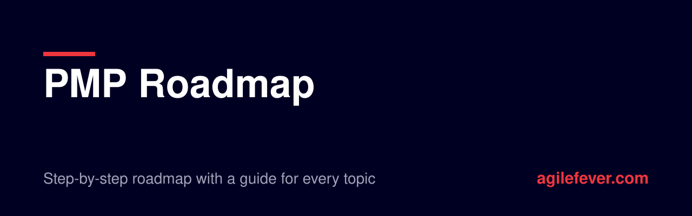

# PMP Roadmap

> PMP Roadmap - A step-by-step roadmap to pass the Project Management Professional (PMP) exam and plan your next certification, with a blog for every topic

## Table of Contents

- [Who is a Project Management Professional?](#who-is-a-project-management-professional)
- [The PMP Exam at a Glance](#the-pmp-exam-at-a-glance)
- [How to Use This Roadmap](#how-to-use-this-roadmap)
- [Step 0: Must Know](#step-0-must-know)
- [Step 1: Is PMP Right for You, and Are You Eligible?](#step-1-is-pmp-right-for-you-and-are-you-eligible)
- [Step 2: The Exam Blueprint](#step-2-the-exam-blueprint)
- [Step 3: Create a High-Performing Team (People)](#step-3-create-a-high-performing-team-people)
- [Step 4: Start the Project (Process)](#step-4-start-the-project-process)
- [Step 5: Planning and Execution](#step-5-planning-and-execution)
- [Step 6: Track Team Performance](#step-6-track-team-performance)
- [Step 7: Keep the Business in Mind (Business Environment)](#step-7-keep-the-business-in-mind-business-environment)
- [Step 8: Agile and Hybrid for the PMP Exam](#step-8-agile-and-hybrid-for-the-pmp-exam)
- [Step 9: Apply to PMI](#step-9-apply-to-pmi)
- [Step 10: Build Your Study Plan](#step-10-build-your-study-plan)
- [Step 11: Exam Day and Keeping Your PMP](#step-11-exam-day-and-keeping-your-pmp)
- [Step 12: After PMP: PMI-ACP and Your Next Step](#step-12-after-pmp-pmi-acp-and-your-next-step)
- [Learn This Roadmap with a Mentor](#learn-this-roadmap-with-a-mentor)
- [License](#license)

### Prepared and maintained by [AgileFever](https://agilefever.com)

### Follow AgileFever

- [LinkedIn](https://www.linkedin.com/company/agilefever/)
- [YouTube](https://www.youtube.com/@AgileFever)
- [X](https://x.com/agilefever)
- [Website](https://agilefever.com)

## Learn with AgileFever

- [PMP Certification Training (Project Management Professional)](https://agilefever.com/project-management/pmp-training-project-management-professional-certification/)
- [PMI-ACP Certification Training (next step)](https://agilefever.com/project-management/pmi-agile-certified-practitioner-training-pmi-acp-certification/)

---

> **Note: We will keep updating this roadmap with new topics and blogs.**

---

### Who is a Project Management Professional?

A Project Management Professional (PMP) is a project manager who has earned the PMP credential from the Project Management Institute (PMI). The credential shows that the person can lead projects using predictive, Agile, and hybrid ways of working, and that they have real project experience behind them.

In simple words, a PMP can:

- **Lead people:** build a team, set ground rules, handle conflict, and keep stakeholders engaged.
- **Run the process:** plan scope, schedule, cost, quality, and risk, then execute and track the work.
- **Keep the business in view:** check that the project delivers the benefit it was approved for, and handle compliance and change.

This is why the PMP exam is not a memory test of formulas. It is a test of judgment. Many questions describe a project situation and ask what a good project manager does next. This roadmap follows the exam content outline and then covers the application, the study plan, and the exam itself.

### The PMP Exam at a Glance

The exam is built on three domains. The weights below come from the course page and the PMI content outline.

| Domain | Share of questions | What it tests |
| --- | --- | --- |
| People | 42% | Leading a team, conflict, stakeholders, emotional intelligence |
| Process | 50% | Planning, risk, schedule, quality, execution, closure |
| Business Environment | 8% | Compliance, benefits and value, organizational change |

The exam has 180 questions in mixed formats (multiple choice, multiple response, matching, hotspot, and limited fill-in-the-blank) and runs for 230 minutes with two short breaks. Always check the PMI website for the current exam details before you apply.

### How to Use This Roadmap

This roadmap is designed so that anyone can follow it in the given order, even without a formal project management background.

- Follow the steps in order. Each step builds on top of the previous one.
- Steps 2 to 7 follow the PMP exam content outline. Steps 8 to 11 cover Agile, the application, study plans, and exam day.
- Inside each step, read the blogs in the given order. Every blog explains one idea in plain words.
- After every step, ask yourself: "If a scenario question on this came up, would I know the next best action?" If yes, move on.
- Where a topic is listed without a link, it is a topic to study from the PMI material and your course notes.

Let's get started.

### Step 0: Must Know

Before the exam topics, we need the basic language of project management. These ideas come up in almost every PMP question.

- [Project cycle management: basics to advanced](https://agilefever.com/project-cycle-management/)
- [Business justification: why a project is approved](https://agilefever.com/project-management-business-justification/)
- [What is effective communication?](https://agilefever.com/effective-communication-definition-examples-benefits/)
- Project, program, and portfolio
- Predictive, Agile, and hybrid approaches
- Project life cycle and phases

### Step 1: Is PMP Right for You, and Are You Eligible?

Check this first so that you plan the right path. PMP needs project experience, 35 hours of project management education, and an application to PMI. Experience must fall within the last eight years before you apply.

- [PMP eligibility: experience, education and training hours](https://agilefever.com/pmp-eligibility/)
- [PMP 35 contact hours: what counts and how to get them](https://agilefever.com/pmp-35-contact-hours/)
- [PMP vs CAPM: eligibility and career fit](https://agilefever.com/pmp-vs-capm/)
- [PMP vs PRINCE2](https://agilefever.com/pmp-vs-prince2/)
- [PMP vs Scrum Master certification](https://agilefever.com/pmp-vs-scrum-master/)
- [PMP training cost: what a 35-hour course should include](https://agilefever.com/pmp-training-cost-35-hour-course/)

### Step 2: The Exam Blueprint

Know how the exam is built before you study for it. The domains, the question types, and the time per question decide how you should practise.

- [PMP exam format: question types, domains and time per question](https://agilefever.com/pmp-exam-format/)
- [PMP passing score: what PMI publishes and what it does not](https://agilefever.com/pmp-passing-score/)
- [How hard is the PMP exam and how to crack it](https://agilefever.com/how-hard-pmp-exam-how-to-crack-pmp-exam/)
- [PMP exam fee: member, non-member and retake](https://agilefever.com/pmp-exam-fee/)

### Step 3: Create a High-Performing Team (People)

The People domain is 42% of the exam. This step covers building the team, setting ground rules, negotiating agreements, empowering and training people, and working with virtual teams.

- [Key steps to building an Agile team](https://agilefever.com/key-steps-to-building-an-agile-team/)
- [Effective communication: definition, examples and benefits](https://agilefever.com/effective-communication-definition-examples-benefits/)
- [Benefits of working with an Agile coach](https://agilefever.com/8-key-benefits-of-using-an-agile-coach/)
- Team ground rules and working agreements
- Negotiating project agreements
- Engaging and supporting virtual teams

### Step 4: Start the Project (Process)

This step covers choosing the right approach and setting up the plan: scope, resources, schedule, quality, procurement, governance, and closure.

- [Project cycle management](https://agilefever.com/project-cycle-management/)
- [Business justification for a project](https://agilefever.com/project-management-business-justification/)
- [Agile vs Scrum: what is the difference?](https://agilefever.com/what-is-the-difference-between-agile-and-scrum/)
- Plan and manage scope
- Plan and manage the schedule
- Plan and manage quality of products and deliverables
- Plan and manage procurement
- Establish a project governance structure

### Step 5: Planning and Execution

Here the plan meets reality. This step covers risk, stakeholders, communication, change control, issue handling, project artifacts, and knowledge transfer.

- [AI agents for project managers: status reports, risk logs and schedules](https://agilefever.com/ai-agents-for-project-managers/)
- [AI in project management: tools, risk and productivity](https://agilefever.com/ai-in-project-management-tools-risk-productivity/)
- [Effective communication in projects](https://agilefever.com/effective-communication-definition-examples-benefits/)
- Assess and manage risks
- Engage stakeholders
- Manage project changes and issues
- Ensure knowledge transfer for project continuity

### Step 6: Track Team Performance

Leadership questions are common on the exam. This step covers leading a team, removing blockers, managing conflict, mentoring, and using emotional intelligence.

- [Agile coaching and why teams benefit from it](https://agilefever.com/8-key-benefits-of-using-an-agile-coach/)
- [Building an Agile team](https://agilefever.com/key-steps-to-building-an-agile-team/)
- Lead a team and support team performance
- Address and remove impediments, obstacles, and blockers
- Manage conflict
- Apply emotional intelligence to promote team performance

### Step 7: Keep the Business in Mind (Business Environment)

This domain is the smallest but it shows up inside many scenario questions. It covers compliance, benefits and value, external change, and organizational change.

- [Business justification and benefits](https://agilefever.com/project-management-business-justification/)
- [Principles of change management](https://agilefever.com/mastering-the-principles-of-change-management-for-streamlined-success/)
- [Change leadership training](https://agilefever.com/master-the-art-of-change-leadership-training-a-guide-to-effective-transformation/)
- Evaluate compliance requirements
- Manage and deliver project benefits and value
- Employ continuous process improvement

### Step 8: Agile and Hybrid for the PMP Exam

A large part of the current exam covers Agile and hybrid delivery, so a project manager who only knows predictive methods will struggle. Learn the Agile basics and how they mix with predictive work.

- [PMP Agile and hybrid questions: what to expect and how to prepare](https://agilefever.com/pmp-agile-and-hybrid-questions/)
- [Agile training for project managers: a PMO plan for hybrid delivery](https://agilefever.com/agile-training-for-project-managers/)
- [Scrum vs Kanban: which Agile tool fits your project](https://agilefever.com/scrum-vs-kanban-which-agile-tool-is-right-for-your-project/)
- [Kanban for project management](https://agilefever.com/kanban-for-project-management-streamlining-workflows-for-success/)
- [What is a Kanban board and how to use it](https://agilefever.com/what-is-kanban-board-how-to-use-it/)

### Step 9: Apply to PMI

Once you have the experience and the 35 hours, you submit an application to PMI. Write your project descriptions in clear, short terms and keep them in line with the PMI framework.

- [PMP application step by step: how to write your project experience](https://agilefever.com/pmp-application/)
- [PMP eligibility check](https://agilefever.com/pmp-eligibility/)
- [PMP certification cost: what to know before you invest](https://agilefever.com/pmp-certification-cost/)
- [PMP certification cost in India](https://agilefever.com/pmp-certification-cost-in-india/)
- [PMP certification cost in the USA](https://agilefever.com/pmp-certification-cost-usa/)

### Step 10: Build Your Study Plan

A plan beats good intentions. Pick a plan that fits your time, and spend most of it on practice questions and on reviewing why an answer was wrong.

- [PMP study plan for working professionals: 8 weeks, 1 hour a day](https://agilefever.com/pmp-study-plan-8-weeks/)
- [PMP in 4 weeks: a fast-track study plan](https://agilefever.com/pmp-in-4-weeks-study-plan/)
- [How to answer PMP situational questions: a 4-step method](https://agilefever.com/pmp-situational-questions/)
- [Corporate PMP training: preparing a group of project managers](https://agilefever.com/corporate-pmp-training/)
- [PMP training for PMO: budget, schedule and reimbursement policy](https://agilefever.com/pmp-training-for-pmo/)

### Step 11: Exam Day and Keeping Your PMP

The exam tests judgment under time pressure. After you pass, the credential needs renewal through professional development units (PDUs).

- [PMP exam format and time per question](https://agilefever.com/pmp-exam-format/)
- [PMP passing score](https://agilefever.com/pmp-passing-score/)
- [PMP renewal: PDUs, where to earn them and what it costs](https://agilefever.com/pmp-renewal-pdus-and-cost/)
- [PDUs for project teams: a yearly learning plan](https://agilefever.com/pdu-plan-for-project-teams/)

### Step 12: After PMP: PMI-ACP and Your Next Step

Once you hold the PMP, the natural next certification for many is the PMI Agile Certified Practitioner (PMI-ACP). It covers Agile principles and mindset, value-driven delivery, stakeholder engagement, team performance, adaptive planning, problem detection, and continuous improvement. [PMI-ACP course page](https://agilefever.com/project-management/pmi-agile-certified-practitioner-training-pmi-acp-certification/).

- [SAFe vs PMI-ACP: which to choose](https://agilefever.com/safe-vs-pmi-acp-choosing-the-right-certification/)
- [Which SAFe certification should a project manager take first?](https://agilefever.com/safe-certification-for-project-managers/)
- [Project manager to AI-augmented program lead: a career transition roadmap](https://agilefever.com/project-manager-to-ai-augmented-program-lead-roadmap/)
- [GenAI and agentic AI for project and program management: the complete guide](https://agilefever.com/genai-agentic-ai-project-program-management-complete-guide/)
- [GenAI and agentic AI use cases for project and program managers](https://agilefever.com/genai-agentic-ai-use-cases-project-program-managers/)

### Learn This Roadmap with a Mentor

If you want to learn this roadmap with a live instructor, AgileFever teaches the [PMP certification course](https://agilefever.com/project-management/pmp-training-project-management-professional-certification/), which follows the exam content outline from People to Business Environment. When you are ready for the Agile side, the [PMI-ACP course](https://agilefever.com/project-management/pmi-agile-certified-practitioner-training-pmi-acp-certification/) is the next step.

### License

This roadmap is licensed under CC BY 4.0. You may share and adapt it with credit to AgileFever.
